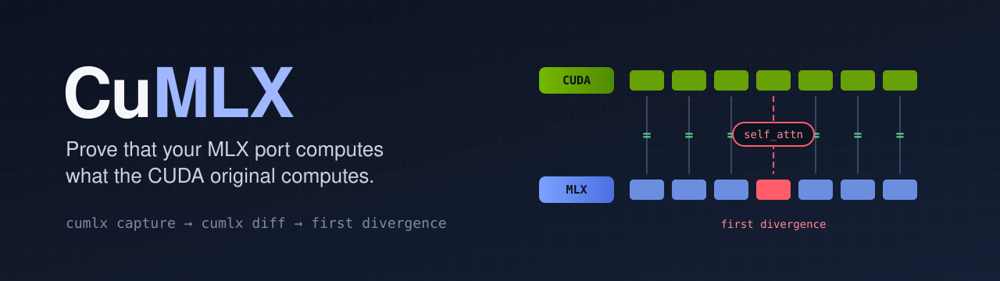

<a id="readme-top"></a>

<div align="center">



<p>
  <a href="https://github.com/Topabaem05/CuMLX/actions/workflows/ci.yml"></a>
  <a href="https://github.com/Topabaem05/CuMLX/actions/workflows/rust.yml"></a>
  
  
  <a href="https://github.com/Topabaem05/CuMLX/blob/main/LICENSE"></a>
</p>

<p>
  <a href="#getting-started"><strong>Get started</strong></a> ·
  <a href="#usage">Usage</a> ·
  <a href="#ports-checked-in-the-wild">Ports checked in the wild</a> ·
  <a href="https://github.com/Topabaem05/CuMLX/blob/main/validation/REPORT.md">Validation report</a> ·
  <a href="https://github.com/Topabaem05/CuMLX/blob/main/docs/CLI.md">CLI reference</a>
</p>

</div>

<details>
  <summary>Table of contents</summary>
  <ol>
    <li><a href="#about-the-project">About the project</a>
      <ul>
        <li><a href="#proof-grades">Proof grades</a></li>
        <li><a href="#built-with">Built with</a></li>
      </ul>
    </li>
    <li><a href="#getting-started">Getting started</a></li>
    <li><a href="#reading-a-cumlx-diff-result">Reading a <code>cumlx diff</code> result</a></li>
    <li><a href="#usage">Usage</a></li>
    <li><a href="#ports-checked-in-the-wild">Ports checked in the wild</a></li>
    <li><a href="#status-and-roadmap">Status and roadmap</a></li>
    <li><a href="#what-was-verified">What was verified</a></li>
    <li><a href="#documentation">Documentation</a></li>
    <li><a href="#contributing">Contributing</a></li>
    <li><a href="#license">License</a></li>
    <li><a href="#acknowledgments">Acknowledgments</a></li>
  </ol>
</details>

## About the project

**CuMLX runs what ran on CUDA on Apple Silicon, and states how close the result is to the original as a proof grade.**

The core of CuMLX is a verifier. It compares an MLX port with the original PyTorch model module by module, and when
they differ it names the first module that diverges. Around the verifier, CuMLX adds paths to run CUDA-only PyTorch
programs, CUDA kernels, robot simulation and camera sensors on a Mac. It does not rebuild these: it connects open
source (mlx-lm, metalsplat, woof, Genesis, MuJoCo, Mitsuba) and checks the result.

A "conversion succeeded" message or plausible generated text is not evidence. A transposed weight, a RoPE offset or a
wrong quantization scale gives wrong values with no error. This is the verdict on a small port with a deliberately
wrong RoPE base ([record](https://github.com/Topabaem05/CuMLX/blob/main/validation/t4-action-example.json)):

```text
diverged: 50 pass, 8 fail, 0 unverified, 6 skipped, 16 chain drift; first divergence at model.layers.1.self_attn (isolated, high)
```

CuMLX does not convert models. Use mlx-lm or another converter, then prove the result with CuMLX.

### Proof grades

Physics and rendering cannot match bit for bit when the implementations differ, so every result carries a grade
([roadmap, section 2](https://github.com/Topabaem05/CuMLX/blob/main/docs/ROADMAP-PLATFORM.md#2-증명-등급)). The tolerance for grade B is fixed before the
measurement and is not changed after the result is known.

| Grade | Meaning | How |
|---|---|---|
| **A, numerically equal** | Same values for the same input, at float32 error level | `cumlx diff`, `check_op`, CUDA golden |
| **B, statistically equal** | The measured metric is inside a tolerance set in advance | Trajectory error, policy reward, PSNR |
| **C, runs** | Runs to the end, with no evidence that it is the same | Smoke test |
| **Unverified** | Not run | - |

A **golden** is the reference that the original program records when it runs: per-module inputs and outputs from
`cumlx capture` for a model, the loss record from `cumlx run --trace-losses` for a training script, and per-operation
records from `cumlx kernel capture` for a kernel.

### Built with

[MLX](https://github.com/ml-explore/mlx) ·
[mlx-lm](https://github.com/ml-explore/mlx-lm) ·
[PyTorch](https://pytorch.org) ·
[Transformers](https://github.com/huggingface/transformers) ·
[Genesis](https://github.com/Genesis-Embodied-AI/Genesis) ·
[MuJoCo](https://github.com/google-deepmind/mujoco) ·
[Mitsuba 3](https://github.com/mitsuba-renderer/mitsuba3) ·
[Rust](https://github.com/Topabaem05/CuMLX/blob/main/rust/README.md) for the torch-free core

<p align="right">(<a href="#readme-top">back to top</a>)</p>

## Getting started

### Prerequisites

- An Apple Silicon Mac (or Linux, where MLX runs on the CPU only)
- Python 3.10 or later

### Installation

CuMLX is not on PyPI yet. Install it from the repository:

```bash
git clone https://github.com/Topabaem05/CuMLX.git && cd CuMLX
python -m pip install -e '.[capture,diff]'
cumlx doctor --require capture,diff,weights     # names what is missing and the command to install it
cumlx selftest                                  # proves in seconds that the verifier works here
```

### Verify a port in three commands

`./my-port` is an MLX port directory that mlx-lm can load. If you do not have one yet, make it with `cumlx port`
(below). A port that is not in mlx-lm format loads with `--loader python:package.module:function`.

```bash
cumlx weights Qwen/Qwen2.5-0.5B ./my-port                        # weights only, in seconds
cumlx capture Qwen/Qwen2.5-0.5B --prompt "Hello" -o golden/      # record the original's per-module I/O
cumlx diff golden/ ./my-port -o report/                          # check the port's code
```

This golden comes from PyTorch on this computer (CPU by default). To compare with CUDA, record it on an NVIDIA machine
with `cumlx capture <original> --prompt "Hello" --device cuda -o golden-cuda/` and run
`cumlx diff golden-cuda/ ./my-port` on the Mac ([procedure](https://github.com/Topabaem05/CuMLX/blob/main/docs/CUDA-GOLDEN.md)).

| Exit code | Meaning |
|---|---|
| `0` | ok |
| `1` | diverged |
| `2`, `3`, `4` | usage, environment, input error |
| `5` | incomplete: some parametrized modules were not compared. **This is not a pass.** Map them with `--mapping rules.json` or ignore them explicitly |
| `10` | internal bug |

Most errors carry the exact fix in `errors[].hint`. `cumlx describe` lists every command and error code.
`report/` receives `report.html`, `report.md` and `report.json`.

On Linux, MLX runs on the CPU only, and `diff` and `weights` were tested only on small CI fixtures.
`capture --device cuda`, `run --target cuda` and `kernel capture` ran on a Tesla V100 under Linux. `kernel verify`
needs Apple Silicon. Do not install the `diff` and `cuda` extras together on Linux.

<p align="right">(<a href="#readme-top">back to top</a>)</p>

## Reading a `cumlx diff` result

`diff` runs in **isolated** mode by default. Each module gets the original's golden input, so errors do not accumulate
and `first_divergence` points at the wrong module. Parent modules that replay it (attention, decoder layer) can fail
with it. `diff` also runs the whole port in its native dtype (**chain**); `--mode chain` judges by that alone.

| `basis`, `confidence` | Meaning |
|---|---|
| `isolated`, high | The module itself is wrong on its golden input. This covers RoPE, mask and residual defects |
| `chain+isolated`, medium | The module could not be replayed; its submodules are right, so the defect is in its own code |
| `chain`, medium | A `--mode chain` result, a NaN or shape error in the native dtype, or a module with no replayable submodule. In chain mode, rerun with `--mode isolated` |

| Warning or field | Meaning |
|---|---|
| `chain_drift` | The module passed on its golden input, but the chain output exceeded the threshold. This is native-dtype rounding, not a failure |
| `W_WEIGHT_ROUNDING_NOISE` | Weight rounding raised the threshold, so smaller defects can pass. Use `--weights-from-mlx` |
| `W_TF32_ACTIVE` | Matmul was measured to run in TF32 (`--tf32 on`, on M5 or CUDA). The threshold rises by that error |
| `W_PARTIAL_TRACE` | Only some modules were recorded (`--layers`). The verdict covers only those |
| `data.execution` | The device and the measured float32 matmul error |

**MLX runs float32 matmul in TF32 by default on M5 and CUDA.** The dtype says float32, but the error is about 1e-3.
CuMLX turns this mode off for the comparison by default and reports the measured error. Use `--tf32 on` to measure
the default behavior that users get.

<p align="right">(<a href="#readme-top">back to top</a>)</p>

## Usage

<details open>
<summary><b>I ported a model to MLX</b></summary>

Run `weights`, `capture` and `diff` as above. For a model that mlx-lm implements, one command converts and proves.
mlx-lm converts; CuMLX verifies.

```bash
cumlx port Qwen/Qwen3-0.6B -o port/              # convert + weights + golden + diff
cumlx port Qwen/Qwen3-0.6B --q-bits 4 -o port4/  # quantized
```
</details>

<details>
<summary><b>I quantized it, or lowered it to bf16/f16</b></summary>

A quantized port always differs from the original by its quantization loss. Compare it with a golden that runs the
original code on the port's own weights; any difference left is an implementation bug. For a bf16/f16 port, start with
the normal golden and switch to this one when `W_WEIGHT_ROUNDING_NOISE` appears. Check the weights themselves with
`cumlx weights`.

```bash
cumlx capture <original> --prompt "Hello" --weights-from-mlx ./my-port-4bit -o golden-p/
cumlx diff golden-p/ ./my-port-4bit
```
</details>

<details>
<summary><b>I want to run a BF16 model on a Mac</b></summary>

That already works, and CuMLX does not rebuild it. [MLX](https://github.com/ml-explore/mlx/blob/main/mlx/backend/metal/kernels/bf16.h)
uses Metal's `bfloat`, [PyTorch MPS](https://github.com/pytorch/pytorch/pull/119641) supports BF16 from macOS 14, and
[llama.cpp](https://github.com/ggml-org/llama.cpp/pull/10218) has Metal BF16 kernels behind a build option. On this Mac
(M5 Pro, macOS 27.0.1, torch 2.15, MLX 0.32.4), matmul, softmax, layer_norm, rms_norm, silu, causal SDPA, cumsum and
topk all ran in BF16 on MPS, with the same error against float64 (2e-3 to 4e-3) as BF16 on the CPU
([record](https://github.com/Topabaem05/CuMLX/blob/main/validation/bf16-mac-probe.json)).

The difference from CUDA is subnormals (values below 2^-126): MPS and the MLX GPU flush them to zero, CUDA and the CPU
keep them. Models rarely show this: of 7,926,976 activations of Qwen2.5-0.5B run in BF16 on a V100, none was
subnormal. The main source of model-level difference is matmul accumulation order, which `cumlx diff` measures per
module.

What CuMLX adds is BF16 arithmetic equal to CUDA. `cumlx_bf16.h`, used by `cumlx kernel port`, keeps subnormals and
rounds once, and matched real CUDA runs bit for bit on a V100 (sm70) and an RTX A4000 (sm86). See
"I want to move a CUDA kernel" below.
</details>

<details>
<summary><b>Answers go wrong only during generation</b></summary>

`capture` records one decode step on the KV cache by default. When prefill is right and only the cache handling
(position offset, mask) is wrong, `first_divergence.phase` is `decode`.
</details>

<details>
<summary><b>I ported a MoE model</b></summary>

The router and the experts are judged apart. Experts are replayed on the original's routing, so router defects and
expert defects are told apart. `cumlx weights` names where a reordered expert went. mlx-lm's `switch_mlp` layout is
supported.
</details>

<details>
<summary><b>Can I trust a published NVFP4 repack?</b></summary>

Compare the bytes of the ModelOpt original with the MLX repack, without running the model. A wrong `global_scale`
convention (a factor of 2688) is named.

```bash
cumlx conform --checkpoint nvidia/MODEL-NVFP4 --against someone/MODEL-MLX-NVFP4
```
</details>

<details>
<summary><b>I want to move a CUDA project</b></summary>

See the size of the work first. `scan` reads the source as text and runs nothing. It ranks findings as `model`,
`device`, `library`, `kernel` and `platform`; `platform` is what cannot move, such as RTX or Omniverse.

```bash
cumlx scan ./some-cuda-repo
cumlx recipe ./some-cuda-repo    # what to use on Apple Silicon for each finding
```

Each option in `recipe` carries its evidence: `evidence: run` means a result from Apple Silicon is in `validation/`,
and `evidence: docs` means only the documentation was read. `--verified-only` keeps only what ran. See
[porting CUDA models](https://github.com/Topabaem05/CuMLX/blob/main/docs/PORTING-CUDA-MODELS.md).
</details>

<details>
<summary><b>I want to run an unmodified CUDA PyTorch program (experimental)</b></summary>

`cumlx run` executes the script on MPS and records every redirected call in `run-report.json`. Inside it,
`torch.cuda.is_available()` is True and the device name says MPS. An operation that MPS lacks ends with an error
instead of a silent CPU fallback, and calls such as streams or `cuda:1` end with `E_RUN_UNSUPPORTED`. It does not
reach compiled CUDA extensions or `python -I` subprocesses, and `torch.version.cuda` stays None.

An **adapter** is a CuMLX module that gives the original package's API on a Mac. It is used only when named with
`--substitute`.

```bash
cumlx run train.py -- --lr 1e-3
cumlx run infer.py --substitute flash_attn=cumlx.compat.flash_attn_sdpa --substitute bitsandbytes=cumlx.compat.bitsandbytes_int8
cumlx run train.py --substitute gsplat=cumlx.compat.gsplat_metalsplat
```

- `cumlx.compat.flash_attn_sdpa`: `flash_attn_func` and `flash_attn_varlen_func` as exact float32 attention. Dropout,
  sliding window, softcap, ALiBi, returned probabilities, paged cache, `flash_attn_with_kvcache` and the 4 packed
  functions are refused.
- `cumlx.compat.bitsandbytes_int8`: LLM.int8 as used by `load_in_8bit=True`, following the CUDA arithmetic of
  bitsandbytes 0.50.2 measured on a V100. 4-bit, training, pre-quantized checkpoints and `bitsandbytes.optim` are refused.
- `cumlx.compat.gsplat_metalsplat`: `gsplat.rasterization` on metalsplat. Pinhole cameras and RGB only.

Running is not evidence of being right, so `W_RUN_NOT_VERIFIED` is always present. To grade a training script, record
losses on an NVIDIA machine and on the Mac, then run `cumlx rundiff`. Grade B needs 3 or more seeds; grade A covers the
first two steps only.

```bash
cumlx run train.py --target cuda --trace-losses --seed 0 --report golden/seed0.json   # NVIDIA machine; also seeds 1, 2
cumlx run train.py --trace-losses --seed 0 --report mps/seed0.json                    # Mac
cumlx rundiff golden/ mps/
```
</details>

<details>
<summary><b>I want to move a CUDA kernel (experimental)</b></summary>

```bash
cumlx kernel capture kernels/ --cases cases.json -o kgolden/ --require-idle-gpu   # on an NVIDIA machine: run the original, record a golden
cumlx kernel port foo.cu -o foo.metal --translator woof                            # headers, templates, host code, PTX built-ins, then translate
cumlx kernel verify foo.metal kgolden/                                             # run the Metal kernel on the golden inputs
```

CuMLX does not install a translator. Whoever accepts its terms installs woof (`metal-woof`). A missing translator is
`E_KERNEL_TRANSLATOR_MISSING` (exit 3), and features with no Metal equivalent are refused with a reason
(`E_KERNEL_UNPORTABLE`). Host code (`main`, ATen) is removed, not translated. A defect on a path the inputs do not
reach cannot be caught, so a pass covers only what the cases ran. Compare a hand-written Metal op with
`cumlx.check_op(torch_fn, mlx_fn, inputs)`.

`__nv_bfloat16` kernels use `cumlx_bf16.h`, written beside the output: 16-bit storage and integer arithmetic. On an
M5 Pro it matched the CUDA model bit for bit on all 2^32 conversions and all 2^32 bf16 pairs for add, subtract and
multiply. It also matched real CUDA runs: conversions on 65,536 inputs on a V100 (sm70), and conversions and
arithmetic on 262,144 inputs on an RTX A4000 (sm86). Division and `__nv_bfloat162` are refused.
</details>

<details>
<summary><b>I want to train and run a robot policy</b></summary>

`cumlx.sim` defines Isaac Lab style tasks (cartpole, Go2 flat) on Genesis and MuJoCo. It is not Isaac Lab or PhysX.
Install the `.[sim,metal]` extras and rsl-rl-lib; a trained policy moves to MLX and is compared with rsl_rl. See
[examples/robot-policy/](https://github.com/Topabaem05/CuMLX/blob/main/examples/robot-policy/).

**Isaac Sim does not run on macOS** (there is no macOS wheel). Run it on an RTX machine and stream to the Mac, or move
only the trained policy to MLX. Work to bring Isaac Sim and Isaac Lab to the Mac stopped on 2026-11-04 because of
licence terms; only the [measurements](https://github.com/Topabaem05/CuMLX/blob/main/validation/archive-orchardsim/) remain.
</details>

<details>
<summary><b>I want camera sensors</b></summary>

`cumlx.render` makes RGB, depth, segmentation and raycast sensors with Mitsuba on Metal (`.[render]`, USD with
`.[usd]`). USD support is small: meshes, one perspective camera, two light types and a diffuse color. Anything else is
refused with `E_RENDER_USD_UNSUPPORTED`. See [examples/physics-camera/](https://github.com/Topabaem05/CuMLX/blob/main/examples/physics-camera/) and
[render sensors](https://github.com/Topabaem05/CuMLX/blob/main/docs/RENDER-SENSORS.md).
</details>

<details>
<summary><b>I want it in my port's CI</b></summary>

```yaml
- uses: Topabaem05/CuMLX@v0.5.0
  with:
    original: Qwen/Qwen2.5-0.5B
    port: ./my-port
    prompt: Hello
```

Only `ok` passes. A divergence or `incomplete` fails the job, and the job summary names the first diverging module.
See [examples/port-ci/](https://github.com/Topabaem05/CuMLX/blob/main/examples/port-ci/).
</details>

<details>
<summary><b>I want to use it from Rust</b></summary>

`describe`, `tracediff` and a `weights` that reads files without MLX also exist in Rust. `cumlx-rs` gives the same
JSON document (`cumlx.result.v1`), exit codes and error codes as Python on valid input;
[tests/test_rust_parity.py](https://github.com/Topabaem05/CuMLX/blob/main/tests/test_rust_parity.py) checks that the verdicts and numbers agree within 1e-12. Other
commands end with exit 3 and `E_PYTHON_ONLY`, with the Python command in `hint`. See [rust/README.md](https://github.com/Topabaem05/CuMLX/blob/main/rust/README.md).

```bash
cargo build --release --manifest-path rust/Cargo.toml
rust/target/release/cumlx-rs weights ./original ./port-mlx
```
</details>

<details>
<summary><b>I want an AI agent to use it</b></summary>

With `--format json` (the default when stdout is not a terminal), stdout is exactly one JSON document, most errors
carry the fix, and the next commands are suggested. `cumlx describe --format json` lists every command and error code.
`cumlx-mcp` serves the same commands as MCP tools; `run`, `kernel capture`, `--trust-remote-code`, `--loader` and
`--translator` appear only when the server starts with `--allow-code-execution`. See the
[agent skill](https://github.com/Topabaem05/CuMLX/blob/main/skills/cumlx-verifier/SKILL.md) and [AGENTS.md](https://github.com/Topabaem05/CuMLX/blob/main/AGENTS.md).
</details>

<p align="right">(<a href="#readme-top">back to top</a>)</p>

## Ports checked in the wild

CuMLX is meant to find defects that nobody notices. So it was pointed at MLX ports that people published on Hugging
Face. The checks below ran on 2026-11-07 and 2026-11-08 with mlx-lm 0.32.2, the latest release.

### A silent RoPE mismatch in real finetunes

transformers 5 saves `rope_theta` inside `rope_parameters`. For llama, mistral, qwen2, phi3 and starcoder2, mlx-lm
reads only a top-level `rope_theta`, and when there is none it uses its own default without a warning. A port
converted from a finetune that was re-saved with transformers 5 then runs a different positional encoding from the
original. Official checkpoints saved earlier still carry the top-level value and are not affected.

**1. Config scan.** [`config_scan.py`](https://github.com/Topabaem05/CuMLX/blob/main/validation/upstream/config_scan.py) read the config.json of 4,864 recent
`mlx`-tagged repositories, without their weights. 587 have `rope_parameters`. In 8 ports from 7 uploaders, mlx-lm
takes a different RoPE base from the one transformers resolves from the same config.

| Port | Type | Base in transformers | Base in mlx-lm |
|---|---|---|---|
| rahulol/Hermit-MiniCPM5-2B-MLX-4bit | llama | 5,000,000 | 10,000 |
| dalatexcoder/MiniCPM5-2B-ARA-MLX-4Bit-optiq-mixed | llama | 5,000,000 | 10,000 |
| dalatexcoder/MiniCPM5-2B-Heretic-ARA-MLX-4Bit | llama | 5,000,000 | 10,000 |
| junafinity/Nanbeige-4.3-33B-Heretic-Uncensored-MLX-4bit | llama | 120,000,000 | 10,000 |
| kilianbalaguer9/Voltaire-2.5-MLX-4bit | llama | 130,000 | 10,000 |
| melmass/Llama-3-8B-LLM2Vec-Kimodo-MLX-4bit | llama | 500,000 | 10,000 |
| masahiroid/Sentiment-Analysis-7B-4bit-mlx | mistral | 1,000,000 | 10,000 |
| imgovind/wrightproduct-v1 | qwen3_moe | 10,000,000 | 1,000,000 |

**2. Proof on the published ports.** [`port_rope_check.py`](https://github.com/Topabaem05/CuMLX/blob/main/validation/upstream/port_rope_check.py) records a golden
of the original architecture with the port's own weights, then runs `cumlx diff` on the port as published and on a
control: the same port with one top-level `rope_theta` line added to its config.

| Port | As published | Control (top-level `rope_theta` added) |
|---|---|---|
| rahulol/Hermit-MiniCPM5-2B-MLX-4bit | **diverged** at `model.layers.0.self_attn` (isolated, high), rel_l2 0.066, 336 modules fail | **ok**, 2036 pass, worst 8.0e-6 |
| dalatexcoder/MiniCPM5-2B-ARA-MLX-4Bit-optiq-mixed | **diverged** at `model.layers.0.self_attn` (isolated, high), rel_l2 0.068, 334 fail | **ok**, 2036 pass, worst 5.1e-6 |
| kilianbalaguer9/Voltaire-2.5-MLX-4bit | **diverged** at `model.layers.0.self_attn` (isolated, high), rel_l2 0.039, 200 fail | **ok**, 1172 pass, worst 4.0e-6 |
| dalatexcoder/MiniCPM5-2B-Heretic-ARA-MLX-4Bit, first 2 of 42 layers | **diverged** at `model.layers.0.self_attn` (isolated, high), rel_l2 0.068, 24 fail | **ok**, 116 pass, worst 4.6e-6 |
| masahiroid/Sentiment-Analysis-7B-4bit-mlx, first 2 of 32 layers | **diverged** at `model.layers.0.self_attn` (isolated, high), rel_l2 0.136, 24 fail | **ok**, 116 pass, worst 2.6e-6 |
| junafinity/Nanbeige-4.3-33B-Heretic-Uncensored-MLX-4bit, first 2 of 52 layers, 11 tokens | **diverged** at `model.layers.0.self_attn` (isolated, high), rel_l2 0.109, 24 fail | **ok**, 116 pass, worst 2.9e-6 |

Records: [validation/upstream/ports/](https://github.com/Topabaem05/CuMLX/blob/main/validation/upstream/ports/). Voltaire's card names no original, so its own config
(without the quantization entries) stands for the original's.

A float32 golden of a 7B model needs about 28 GB, more than this Mac had free. For the last three rows, `--layers 2`
keeps the first 2 decoder layers, the embedding, the final norm and the head, and downloads only the shards that hold
them. A RoPE base defect shows in layer 0. For the 33B, `--vocab-from-prompts` also keeps only the embedding and head
rows of the prompt tokens. A 4-bit row is quantized on its own, so every activation is unchanged. On Voltaire, a full
check and both cuts gave the same first divergence (rel_l2 0.038986802532664726), and a port without the defect passed
both cuts. These verdicts cover the first 2 layers only.

Of the 8 flagged ports, 6 are now confirmed on the port itself. melmass/Llama-3-8B-LLM2Vec-Kimodo-MLX-4bit is not an
mlx-lm port: it is a bidirectional encoder (`LlamaBiModel`) with no `lm_head`, and its quantization is stored outside
config.json, so its own loader reads it. The qwen3_moe port (78 GB) is checked at config level only.

The control passing proves that the RoPE base is the whole defect.

**3. How much it matters.** Short prompts hide it: on the 12 positions above, the first port still chose the same
top-1 token 9 times. On non-repeating text ([`long_context_effect.py`](https://github.com/Topabaem05/CuMLX/blob/main/validation/upstream/long_context_effect.py)),
the published port chose a different next token from the control at this share of positions:

| Input length (tokens) | 16 | 64 | 256 | 1,024 | 2,048 |
|---|---|---|---|---|---|
| Top-1 differs, Hermit-MiniCPM5-2B | 31% | 36% | 36% | 39% | 46% |
| Top-1 differs, Sentiment-Analysis-7B (whole port in MLX) | 19% | 22% | 18% | 22% | 24% |

**Upstream.** The open pull request [ml-explore/mlx-lm#1964](https://github.com/ml-explore/mlx-lm/pull/1964) fixes 7 of
the 8 configs. It does not fix the qwen3_moe config, whose top-level `rope_theta` disagrees with `rope_parameters`:
transformers takes `rope_parameters`, and the pull request keeps the top-level value. mlx-lm's contribution policy
requires a person to write bug reports, so this is **not reported yet**. The evidence and the reproduction are in
[validation/upstream](https://github.com/Topabaem05/CuMLX/blob/main/validation/upstream/README.md) (in Korean).

### Clean results

Earlier, 9 of 10 `mlx-community` ports passed and 1 could not load
([record](https://github.com/Topabaem05/CuMLX/blob/main/validation/public-ports.json)). 7 of 12 recent Hugging Face models passed on both the implementation and a
4-bit conversion ([record](https://github.com/Topabaem05/CuMLX/blob/main/validation/latest-models.json)).

<p align="right">(<a href="#readme-top">back to top</a>)</p>

## Status and roadmap

24 of the 25 completion conditions in the [platform roadmap](https://github.com/Topabaem05/CuMLX/blob/main/docs/ROADMAP-PLATFORM.md) are met. The one left is M6's
"reproduce the flagship tasks from scratch on a new Mac". The project has one Mac (Apple M5 Pro, 48 GB), and a result
from the same Mac is not counted.

The **flagship tasks** are five tasks the roadmap chose to judge whether the platform is useful, each with a target
grade. In the first complete run on 2026-11-06, F2 to F5 reached their target grade and F1 failed
([record](https://github.com/Topabaem05/CuMLX/blob/main/validation/m6-finish-run.json)). **F1 reached grade A on 2026-11-07, in the first complete run under new
rules** that were committed before the run ([record](https://github.com/Topabaem05/CuMLX/blob/main/validation/m6-f1-rerun.json)). F1, F2, F3 and F5 compare a clean
environment on this Mac with CUDA on a Tesla V100.

| Task | Mac path | Target | Result | Evidence (rel_l2 is relative L2 error) |
|---|---|---|---|---|
| F1 LLM inference with FlashAttention + bitsandbytes | `cumlx run` + 2 adapters | A | **A** | 168 int8 layers worst 3.0e-7 (limit 2e-3), decoder layers worst 7.5e-3 (limit 1.5e-2), 20 of 20 tokens equal, 5 controls caught |
| F2 3D Gaussian Splatting training | `cumlx run` + gsplat adapter | B | **B** | Render against real gsplat 1.5.3 worst 3.6e-7, gradients 2.6e-6, held-out PSNR Mac 43.15 dB against CUDA 43.50 dB |
| F3 custom `.cu` kernel app (SAM2 connected components) | `cumlx kernel port` + woof | A | **A** | Labels and counts equal to the original CUDA extension; 3 driver defects caught |
| F4 Isaac Lab style quadruped training and inference | `cumlx.sim` + MLX | inference A, physics B | **A, B** | MLX policy against rsl_rl worst 1.7e-6; Genesis against MuJoCo trajectory median 0.024 (limit 0.1) |
| F5 physically based camera sensors | `cumlx.render` | B | **B** | RGB PSNR between devices worst 45.65 dB, depth worst 3.4e-5 m, 0 segmentation mismatches |

Limits, failures and the full record are in the [platform report](https://github.com/Topabaem05/CuMLX/blob/main/docs/PLATFORM-REPORT.md).

Open items that need the owner: the PyPI release ([procedure](https://github.com/Topabaem05/CuMLX/blob/main/docs/RELEASE.md)) and the upstream report of the
mismatches below, which mlx-lm's contribution policy requires a person to write.

<p align="right">(<a href="#readme-top">back to top</a>)</p>

## What was verified

Hardware: one Apple M5 Pro (Metal, CPU), Linux MLX CPU (CI, small fixtures), one Tesla V100 (CUDA). One BF16 kernel
also ran on one RTX A4000 rented on vast.ai. Each record has its own scope ([validation report](https://github.com/Topabaem05/CuMLX/blob/main/validation/REPORT.md)).

- 38 runs of clean real ports (Qwen2.5-0.5B, SmolLM2-135M, small public MoE, 5 inputs): 0 false alarms.
- 50 fault-injection runs (F1 to F11): 0 missed, 3 not applicable.
- Published `mlx-community` ports: 9 of 10 ok, 1 could not load.
- Ports that people published (2026-11-07 and 2026-11-08): 4,864 configs scanned, 8 flagged for a silent RoPE
  mismatch, 6 confirmed by `cumlx diff` with a control that passes (3 of them, up to 33B, on the first 2 layers), 1 not
  an mlx-lm port.
- 12 recent Hugging Face models (2026-11-02): 7 ok on both the implementation and a 4-bit conversion.
- The flagship tasks, only in the scope of the table above.

**Not verified:** other Macs and Apple GPU generations, NVIDIA GPUs other than the V100 (except one BF16 kernel run on
an RTX A4000), the FlashAttention-2 binary, padded inputs, speech and image models, RTX sensors. The full list is in
[UNVERIFIED.md](https://github.com/Topabaem05/CuMLX/blob/main/docs/UNVERIFIED.md). Thresholds are measurements from the scope above.

<p align="right">(<a href="#readme-top">back to top</a>)</p>

## Documentation

Most documents are in Korean. The CLI output, error codes, [AGENTS.md](https://github.com/Topabaem05/CuMLX/blob/main/AGENTS.md), the
[validation report](https://github.com/Topabaem05/CuMLX/blob/main/validation/REPORT.md) and the [Rust core](https://github.com/Topabaem05/CuMLX/blob/main/rust/README.md) are in English.

| Document | Content |
|---|---|
| [Platform report](https://github.com/Topabaem05/CuMLX/blob/main/docs/PLATFORM-REPORT.md) | Conditions and flagship tasks: state, grade, failures |
| [Validation report](https://github.com/Topabaem05/CuMLX/blob/main/validation/REPORT.md) | Real model runs, fault injection, CUDA goldens |
| [Unverified](https://github.com/Topabaem05/CuMLX/blob/main/docs/UNVERIFIED.md) | What was not checked |
| [CLI](https://github.com/Topabaem05/CuMLX/blob/main/docs/CLI.md) | Commands, verdicts, thresholds, adapters, measurement records |
| [AGENTS.md](https://github.com/Topabaem05/CuMLX/blob/main/AGENTS.md) | Use and development with an AI agent |
| [Trace format](https://github.com/Topabaem05/CuMLX/blob/main/docs/TRACE-FORMAT.md) | Public specification of the golden trace |
| [CUDA golden](https://github.com/Topabaem05/CuMLX/blob/main/docs/CUDA-GOLDEN.md) | V100 measurements and how to record on another NVIDIA machine |
| [Porting CUDA models](https://github.com/Topabaem05/CuMLX/blob/main/docs/PORTING-CUDA-MODELS.md) | What converts, the Isaac Sim review, `scan` and `port` |
| [Render sensors](https://github.com/Topabaem05/CuMLX/blob/main/docs/RENDER-SENSORS.md) | `cumlx.render` and how it differs from RTX sensors |
| [Platform roadmap](https://github.com/Topabaem05/CuMLX/blob/main/docs/ROADMAP-PLATFORM.md) | Milestones for Apple Silicon execution |
| [One-month roadmap](https://github.com/Topabaem05/CuMLX/blob/main/docs/ROADMAP-1MONTH.md) | Verifier milestones |
| [FP4 kernel lab](https://github.com/Topabaem05/CuMLX/blob/main/docs/FP4-KERNEL-LAB.md) | Experimental NVFP4/MXFP4 Metal and CUDA kernels |
| [CI](https://github.com/Topabaem05/CuMLX/blob/main/docs/CI.md) | Automatic checks and the GPU boundary |
| [Release](https://github.com/Topabaem05/CuMLX/blob/main/docs/RELEASE.md) | PyPI release procedure |
| [Changelog](https://github.com/Topabaem05/CuMLX/blob/main/CHANGELOG.md) | Changes per release |

<p align="right">(<a href="#readme-top">back to top</a>)</p>

## Contributing

Issues and pull requests are welcome. Before you open a pull request:

```bash
python -m pip install -e '.[dev,capture,diff]'
python -m ruff check .
python -m pytest -q -m 'not gpu'
```

Rules that keep the verifier honest: never turn a skip, an unmapped module or a missing dependency into a pass, and
never raise a threshold to clear a failure. Find the cause first. A new fault goes in `verify/faults.py` and must be
located in `tests/test_verify_e2e.py`. A change to the metrics, weights or trace code needs the same change in
`rust/`. See [AGENTS.md](https://github.com/Topabaem05/CuMLX/blob/main/AGENTS.md#developing-this-repository).

<p align="right">(<a href="#readme-top">back to top</a>)</p>

## License

MIT. See [LICENSE](https://github.com/Topabaem05/CuMLX/blob/main/LICENSE). CuMLX is not an official Apple or NVIDIA project.

## Acknowledgments

- [MLX](https://github.com/ml-explore/mlx) and [mlx-lm](https://github.com/ml-explore/mlx-lm), which do the conversion
  and run the ports
- [Genesis](https://github.com/Genesis-Embodied-AI/Genesis), [MuJoCo](https://github.com/google-deepmind/mujoco),
  [Mitsuba 3](https://github.com/mitsuba-renderer/mitsuba3), metalsplat and woof, which CuMLX connects
- [Best-README-Template](https://github.com/othneildrew/Best-README-Template), the layout of this README

<p align="right">(<a href="#readme-top">back to top</a>)</p>
